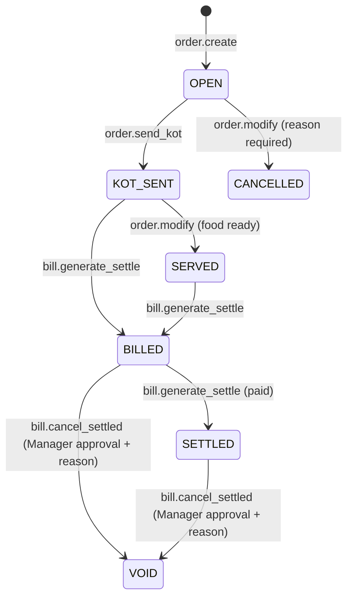
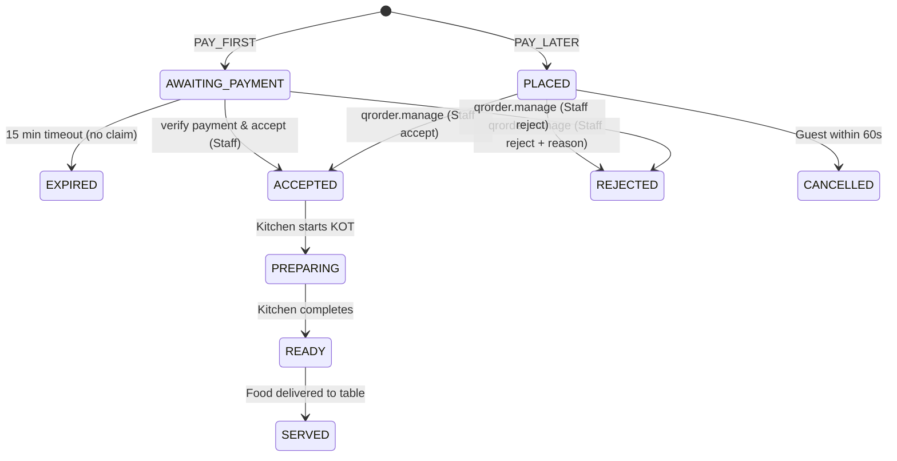
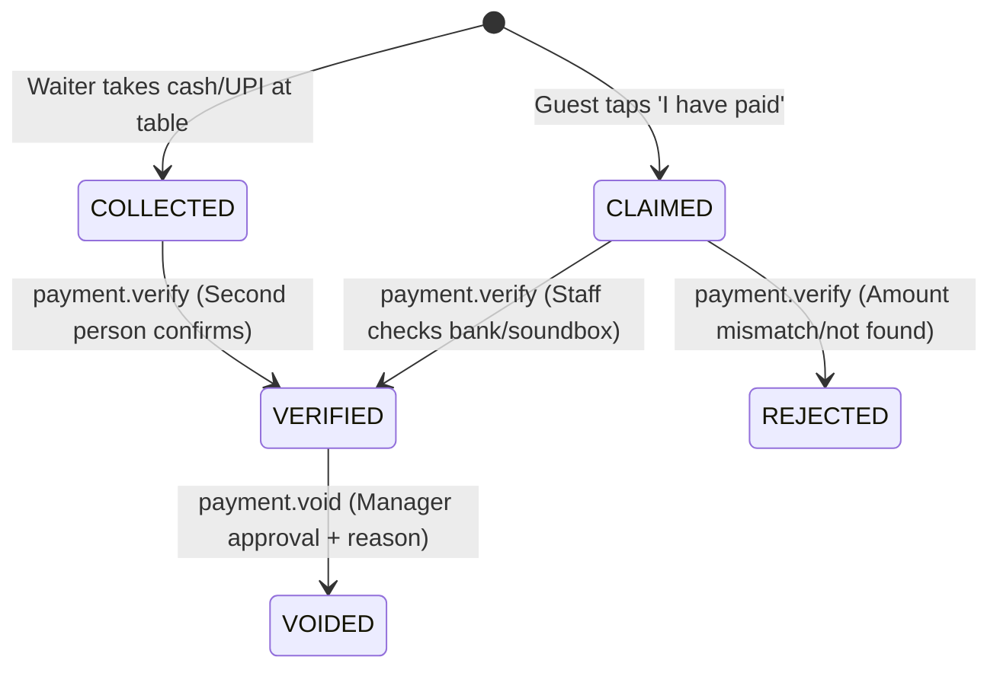

# KIVO POS — Master Architectural Brain (BRAIN.md)
*System Architecture, Cryptographic Specs, Domain Models, State Machines, Security & Edge Case Directory*  
*Version: 1.1 | Date: November 2026 | Deployment Target: Hostinger KVM 2 VPS (2 vCPU, 8 GB RAM)*

---

## 0. Non-Negotiable Senior Engineering Protocol & Verification Loop

To ensure production safety and eliminate regression risks in mission-critical restaurant operations, this invariant verification loop must be strictly executed on every micro-phase:

```
[1. Scoped Code Change] (Max 2-5 files)
           │
           ▼
[2. TypeScript Strict Check] (`tsc --noEmit` across backend and web)
           │
           ▼
[3. Automated Test Suite] (330 backend tests + 59 web tests must stay 100% green)
           │
           ▼
[4. Edge Case & Concurrency Audit] (Race conditions, IDOR, null safety, rate limits)
           │
           ▼
[5. Bug / Regression Found?]
      ├── YES ──> Patch immediately -> Re-run loop from Step 2
      └── NO  ──> Report proof to User -> Commit -> Wait for approval
```

### Invariant Rules:
1. **Never Skip Tests to Save Turns:** Full automated test suites must pass before declaring any step finished.
2. **Additive-Only Migrations:** No drops, renames, or type changes on existing columns or enums.
3. **Zero Business Logic Assumptions:** Clarify all ambiguous rules before writing code.
4. **Hard Scoping:** Every micro-phase touches only its declared scope to prevent sprawling bugs.

---

## 1. System Architecture & Topology

### 1.1 Deployment Topology (Single Hostinger KVM 2 VPS)
```
                  Internet (Port 80 / 443)
                             │
                             ▼
              ┌─────────────────────────────┐
              │     Caddy Edge Proxy        │
              │  (Auto-HTTPS, TLS Term,     │
              │   Gzip/Brotli, Static Cache)│
              └──────────────┬──────────────┘
                             │
             ┌───────────────┴───────────────┐
             │ Internal Docker Bridge Network│
             ▼                               ▼
  ┌───────────────────────┐      ┌───────────────────────┐
  │     Next.js Web       │      │     NestJS API        │
  │  (Dashboard + Guest   │      │  (RBAC, Orders, QR,   │
  │   Mobile /q/:token)   │      │   Payments, Auth)     │
  └───────────────────────┘      └───────────┬───────────┘
                                             │
                       ┌─────────────────────┴─────────────────────┐
                       ▼                                           ▼
          ┌─────────────────────────┐                 ┌─────────────────────────┐
          │   PostgreSQL + PgBouncer│                 │     Redis (Cache,       │
          │  (Multi-tenant DB,      │                 │  Rate Limits, BullMQ,   │
          │   Max Pool: 25 conns)   │                 │   Permission Version)   │
          └─────────────────────────┘                 └─────────────────────────┘
```

### 1.2 Resource Allocation Guardrails (8 GB RAM Constraint)
- **PostgreSQL:** `shared_buffers = 1536MB`, `effective_cache_size = 4096MB`, `work_mem = 16MB`, `maintenance_work_mem = 256MB`.
- **PgBouncer:** Max client connections = 250; default pool size = 20; reserve pool = 5 (strictly protects Postgres from thread starvation).
- **Redis:** `maxmemory 512mb`, `maxmemory-policy allkeys-lru`.
- **NestJS API Container:** Limit: 1.5 GB RAM, 1.2 vCPU.
- **Next.js Web Container:** Limit: 1.5 GB RAM, 0.8 vCPU.
- **Worker Container:** Shares the API image; Limit: 512 MB RAM.
- **Zero Headless Browsers:** No Puppeteer, Chromium, or native `canvas` packages anywhere in the image. Pure JS `qrcode` and headless `@react-pdf/renderer` only.

### 1.3 Co-Hosting Architecture on Shared VPS (Multi-Project & Multi-Domain)
When the target VPS already hosts existing projects and domains:
1. **Zero Filesystem Interference:** KIVO operates in its own dedicated directory (`/opt/futorakivo` or `/home/deploy/futorakivo`) and runs entirely within isolated Docker containers and internal networks.
2. **Reverse Proxy Domain Routing (SNI / Host-Header Multiplexing):**
   - The VPS reverse proxy (Caddy or Nginx) binds public ports 80 (HTTP) and 443 (HTTPS).
   - Incoming traffic is routed strictly by domain name:
     - `existing-app.com` -> routed to internal port (e.g. `localhost:3000` or existing container network).
     - `kivoko.in` / `api.kivoko.in` -> routed to KIVO containers (`localhost:1995` / `localhost:4000`).
   - Both domains receive independent, automatic SSL/TLS certificates (Let's Encrypt / ZeroSSL).
3. **Database Isolation:** KIVO runs its own isolated PostgreSQL container and Redis container on internal Docker ports (`5432` and `6379` internal), preventing any collision with existing MySQL or Postgres databases on the host.
4. **RAM Safeguards (Docker Memory Limits):**
   - KIVO containers enforce hard memory limits (`mem_limit: 4G` across all KIVO services combined) to guarantee KIVO cannot cause Out-Of-Memory (OOM) crashes for the pre-existing project.

---

## 2. Cryptographic Specifications & Security Protocols

### 2.1 6-Digit Staff PIN Security Architecture
```
Staff enters PIN: "583921"
           │
           ▼
[Device Check] ──> Must have valid, unexpired, APPROVED Device Cookie (256-bit token hash)
           │
           ▼
[Lookup Hash]  ──> pinLookup = HMAC-SHA256(SERVER_PEPPER, restaurantId + ":" + pin)
           │       Queried against UNIQUE INDEX(restaurantId, pinLookup) where isActive = true
           ▼
[User Found?]  ──> If found: verify password/pin hash using Argon2id(pin, user.pinSalt)
           │       If not found: run dummy Argon2id hash to equalize response timing
           ▼
[Lockout Check]──> device.failedAttempts >= 5 ? 
                   Yes -> lockedUntil = now + 15 min; throw HTTP 429
                   No  -> issue JWT session bound to deviceId + permissionsVersion
```
- **Pepper Key Rotation:** Stored in environment as `SERVER_PEPPER_V1`. The database stores `pepperKeyId = "v1"`. On pepper rotation to `v2`, authenticating users are seamlessly re-hashed and their `pepperKeyId` updated.

### 2.2 Device Pairing & Token Authentication
- **Pairing Code:** 6-character alphanumeric slug, 10-minute TTL, bound to `(restaurantId, outletId)`.
- **Approval:** Owner approves pending device in dashboard. Server generates 256 bits of cryptographically secure randomness.
- **Storage:** Database stores only `SHA-256(rawToken)`. Client receives raw token in `httpOnly`, `Secure`, `SameSite=Lax` cookie.
- **Revocation:** Setting status to `REVOKED` terminates all active sessions tied to `deviceId` immediately via Redis session cache purge.

### 2.3 Manager Approval Token Engine
- **Trigger:** Staff without required permission key attempts protected action (e.g. `order.cancel_item`). Server returns `403 APPROVAL_REQUIRED` with `{ permissionKey, targetEntity, targetId }`.
- **Verification:** Manager inputs 6-digit PIN on the same device.
- **Token Generation:** Single-use cryptographic token valid for **2 minutes**:
  $$\text{ApprovalToken} = \text{HMAC-SHA256}(\text{SECRET}, \text{key} + \text{targetId} + \text{requesterId} + \text{deviceId} + \text{payloadHash} + \text{exp})$$
- **Atomic Consumption:** Consumed in the same PostgreSQL transaction as the actual business action. Replays, target alterations, or expired uses fail instantly.

---

## 3. Comprehensive Domain Data Dictionary

### 3.1 New & Extended Database Models (Prisma)

```prisma
// 1. Devices & Auth
model DeviceRegistration {
  id              String       @id @default(cuid())
  restaurantId    String
  outletId        String
  label           String       // e.g. "Counter Terminal 1"
  status          DeviceStatus @default(PENDING) // PENDING, APPROVED, REVOKED
  tokenHash       String?      @unique
  userAgent       String?
  lastSeenAt      DateTime?
  lastIp          String?
  approvedBy      String?
  approvedAt      DateTime?
  revokedBy       String?
  revokedAt       DateTime?
  failedAttempts  Int          @default(0)
  lockedUntil     DateTime?
  createdAt       DateTime     @default(now())
  updatedAt       DateTime     @updatedAt
}

model PinAttempt {
  id           String   @id @default(cuid())
  restaurantId String
  deviceId     String
  ip           String
  success      Boolean
  attemptedAt  DateTime @default(now())
  @@index([deviceId, attemptedAt])
  @@index([restaurantId, attemptedAt])
}

model ApprovalLog {
  id            String   @id @default(cuid())
  restaurantId  String
  requesterId   String
  approverId    String
  permissionKey String
  targetEntity  String
  targetId      String
  reason        String   // mandatory (min 5 chars)
  deviceId      String
  outcome       String   @default("APPROVED") // APPROVED, USED, EXPIRED, DENIED
  createdAt     DateTime @default(now())
  @@index([restaurantId, createdAt])
}

// 2. Tables, Sessions & Split Bills
model TableAssignment {
  id          String    @id @default(cuid())
  outletId    String
  tableId     String
  staffUserId String
  assignedBy  String
  assignedAt  DateTime  @default(now())
  releasedAt  DateTime?
  @@index([outletId, tableId, releasedAt])
}

model TableSession {
  id           String             @id @default(cuid())
  restaurantId String
  outletId     String
  tableId      String
  status       TableSessionStatus @default(ACTIVE) // ACTIVE, CLOSED
  openedAt     DateTime           @default(now())
  expiresAt    DateTime           // now + idle hours
  closedAt     DateTime?
  closedBy     String?
  closedReason String?
  @@index([outletId, tableId, status])
}

model Bill {
  id             String            @id @default(cuid())
  restaurantId   String
  outletId       String
  tableSessionId String?
  guestSessionId String?           @unique
  billNumber     String            // e.g. "BILL-20261123-0001"
  status         BillPaymentStatus @default(UNPAID) // UNPAID, PARTIALLY_PAID, PAID
  subtotalPaise  Int               @default(0)
  discountPaise  Int               @default(0)
  taxPaise       Int               @default(0)
  totalPaise     Int               @default(0)
  paidPaise      Int               @default(0)
  version        Int               @default(1) // Optimistic locking
  invoiceDate    DateTime?
  createdAt      DateTime          @default(now())
  updatedAt      DateTime          @updatedAt
  @@unique([outletId, billNumber])
}

// 3. Append-Only Event Log (Protected by PostgreSQL Triggers)
model OrderEvent {
  id           String   @id @default(cuid())
  restaurantId String
  outletId     String
  entity       String   // Order, Bill, QrOrder, PaymentRecord
  entityId     String
  eventType    String   // PLACED, ACCEPTED, KOT_SENT, ITEM_CANCELLED, VOIDED, etc.
  actorType    String   // STAFF | GUEST | SYSTEM
  actorId      String?
  deviceId     String?
  reason       String?
  approvalId   String?
  beforeState  Json?
  afterState   Json?
  createdAt    DateTime @default(now())
  @@index([restaurantId, outletId, entityId])
}

// 4. Guest QR Menu & Self-Ordering
model QrSettings {
  id                  String   @id @default(cuid())
  outletId            String   @unique
  enabled             Boolean  @default(false)
  mode                String   @default("MENU_ONLY") // MENU_ONLY, MENU_AND_ORDER
  approvalMode        String   @default("STAFF_ACCEPT") // STAFF_ACCEPT, AUTO_ACCEPT
  paymentTiming       String   @default("PAY_LATER") // PAY_FIRST, PAY_LATER
  allowedPaymentMethods String[] @default(["ONLINE_QR", "WAITER_AT_TABLE", "COUNTER"])
  showImages          Boolean  @default(true)
  showPrices          Boolean  @default(true)
  outOfStock          String   @default("GREY_OUT") // HIDE, GREY_OUT
  languages           String[] @default(["en", "hi"])
  themeColor          String   @default("#FF6B35")
  orderingPaused      Boolean  @default(false)
  maxItemsPerOrder    Int      @default(30)
  maxQtyPerLine       Int      @default(20)
  orderCooldownSec    Int      @default(15)
  unpaidExpiryMinutes Int      @default(15)
  tableSessionIdleHours Int    @default(4)
  consentText         String   @default("I agree to share my name and number for order and billing service.")
  createdAt           DateTime @default(now())
  updatedAt           DateTime @updatedAt
}

model QrCode {
  id           String    @id @default(cuid())
  restaurantId String
  outletId     String
  type         String    // TABLE, COUNTER
  tableId      String?
  tokenHash    String    @unique // SHA-256 of opaque token
  status       String    @default("ACTIVE") // ACTIVE, ROTATED
  rotatedAt    DateTime?
  createdAt    DateTime  @default(now())
  @@index([tokenHash])
}

model GuestSession {
  id                 String   @id @default(cuid())
  tableSessionId     String
  name               String
  phone              String   // Normalized +91...
  cookieSecretHash   String   @unique
  trackingTokenHash  String   @unique
  consentAt          DateTime @default(now())
  consentTextVersion String   @default("v1.0")
  blocked            Boolean  @default(false)
  createdAt          DateTime @default(now())
  @@index([tableSessionId])
}

model QrOrder {
  id             String   @id @default(cuid())
  restaurantId   String
  outletId       String
  tableSessionId String
  guestSessionId String
  status         String   @default("PLACED") // PLACED, AWAITING_PAYMENT, ACCEPTED, REJECTED, CANCELLED, EXPIRED
  tokenNumber    String?  // Daily counter token
  subtotalPaise  Int      @default(0)
  taxPaise       Int      @default(0)
  totalPaise     Int      @default(0)
  idempotencyKey String   @unique
  notes          String?  // max 200 chars
  paymentTiming  String   @default("PAY_LATER")
  orderId        String?  @unique
  version        Int      @default(1)
  rejectedReason String?
  rejectedBy     String?
  acceptedBy     String?
  createdAt      DateTime @default(now())
  updatedAt      DateTime @updatedAt
  @@index([outletId, status])
}

model QrOrderItem {
  id             String   @id @default(cuid())
  qrOrderId      String
  menuItemId     String
  quantity       Int
  unitPricePaise Int
  portionType    String?
  kitchenNote    String?
  modifierSelections Json?
  createdAt      DateTime @default(now())
}

// 5. Payments (Manual UPI QR)
model OutletPaymentConfig {
  id           String   @id @default(cuid())
  outletId     String   @unique
  qrImageKey   String
  qrImageHash  String
  upiId        String
  payeeName    String
  changedBy    String
  changedAt    DateTime @default(now())
}

model PaymentRecord {
  id            String    @id @default(cuid())
  restaurantId  String
  outletId      String
  billId        String
  mode          String    // UPI, CASH, CARD
  amountPaise   Int
  state         String    @default("CLAIMED") // CLAIMED, COLLECTED, VERIFIED, REJECTED, VOIDED
  referenceCode String    // 6-char daily unique ref code
  claimedAt     DateTime?
  collectedBy   String?
  verifiedBy    String?
  verifiedAt    DateTime?
  rejectedReason String?
  selfVerified  Boolean   @default(false)
  notes         String?
  createdAt     DateTime  @default(now())
  updatedAt     DateTime  @updatedAt
  @@index([outletId, state])
}
```

---

## 4. State Machines & Formal Transition Rules

### 4.1 Staff POS Order Lifecycle


### 4.2 Guest QrOrder Lifecycle


### 4.3 Payment Record Lifecycle


---

## 5. Granular 38-Permission Keys Matrix

All role checks in code inspect `permissionSatisfied(user.permissions, key)`. Roles are strictly seeds/templates.

1. `table.view`: Floor plan, table status.
2. `order.create`: Initiate table/counter orders.
3. `order.send_kot`: Dispatch tickets to kitchen stations.
4. `order.modify`: Edit own orders or assigned tables.
5. `order.modify_any`: Edit any staff member's order.
6. `order.modify_after_kot`: Modify items after KOT is printed (Reason + Approval for Captain/Waiter).
7. `order.cancel_item`: Cancel an item on an active order (Reason + Approval for Cashier/Captain/Waiter).
8. `table.transfer_merge`: Move or merge table orders.
9. `table.assign`: Assign tables to floor staff.
10. `bill.generate_settle`: Generate invoice and settle payment.
11. `bill.reprint`: Print bill copy.
12. `bill.cancel_settled`: Void a settled bill (Manager reason required).
13. `bill.move_item`: Transfer items between split bills before invoice.
14. `discount.apply_small`: Apply discount $\le 5\%$.
15. `discount.apply_any`: Apply discount $> 5\%$ (Approval required for Cashier).
16. `refund.process`: Process bill refunds (Manager reason required).
17. `kot.reprint`: Reprint kitchen tickets.
18. `kitchen.view_kot`: KDS view and ticket updates.
19. `item.mark_out_of_stock`: Item 86 toggle (instant sync to QR).
20. `menu.view`: Read-only menu access.
21. `menu.edit`: Edit dishes, categories, and prices.
22. `payment.collect`: Collect money at table or counter.
23. `payment.verify`: Confirm bank receipt / soundbox chime.
24. `payment.void`: Void a verified payment (Approval required).
25. `qrorder.view`: View incoming guest orders queue.
26. `qrorder.manage`: Accept, reject, or edit guest orders.
27. `qr.pause_ordering`: Emergency pause toggle for QR menu.
28. `qr.generate`: Generate and rotate QR tokens.
29. `qrsettings.manage`: Modify theme, hours, and display rules.
30. `qrsettings.payment`: Upload UPI QR & change UPI ID (Owner PIN required).
31. `guest.block`: Block abusive guest sessions or phone numbers.
32. `device.manage`: Pair, approve, and revoke POS terminals.
33. `device.unlock`: Unlock device locked by 5 failed PINs.
34. `staff.manage`: Create staff, assign roles, reset PINs.
35. `reports.view_basic`: Shift summary and daily sales.
36. `reports.view_all`: Full P&L, audits, tax reports.
37. `settings.tax`: Edit GST slabs and service charges.
38. `data.bulk_delete`: Purge test data or historical data.

---

## 6. Comprehensive Edge Case Directory

1. **Two guests order simultaneously on Table 4:** Separate `GuestSession` records create separate `QrOrder` entries attached to distinct `Bill` records with isolated idempotency keys.
2. **Guest scans rotated QR:** Token lookup fails; server renders a friendly "This QR code has been rotated. Please contact your server." screen.
3. **Item becomes unavailable after guest adds to cart:** During the quote/submit step, server validates stock status. Unavailable items return HTTP 422 with a clear notice.
4. **Internet severed during submit:** Client retries using the identical `Idempotency-Key`. The server returns the cached initial response without creating duplicate orders.
5. **Rogue staff attempts UPI QR image swap:** Changing payment settings requires the Owner's 6-digit PIN. The server decodes the QR image to ensure the embedded VPA matches the entered text and dispatches instant email/SMS alerts to the Owner.
6. **Thermal printer disconnects:** Acceptance succeeds atomically in PostgreSQL. The print job is enqueued in `PrintJob` with exponential backoff retries and displayed on the KDS screen.
7. **5 Failed PIN attempts on POS:** Terminal locked for 15 minutes. Automatically unlocks after timeout or instantly via Owner/Manager remote unlock.
8. **Guest claims payment right at 15-minute expiry:** The background expiry worker checks `PaymentRecord` state. Any order with an active `CLAIMED` payment is excluded from automated expiration.
9. **Guest enters another person's phone number:** Phone numbers are strictly treated as contact labels. They cannot authenticate, view past orders, or retrieve historical data.
10. **Mid-service Table Reassignment:** Reassignment is logged to `order_events` and pushed to both staff terminals via WebSocket.
