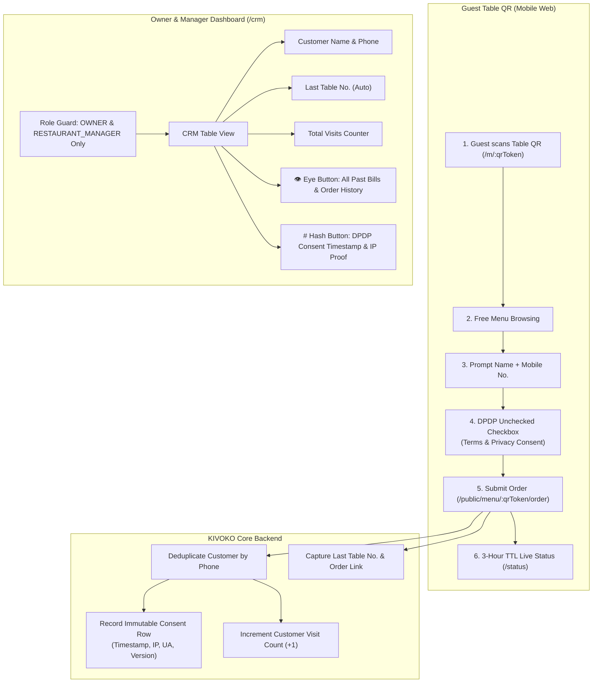

# Volume 09-B: DPDP Act 2023 & Restaurant CRM Technical Implementation Specification

> **KIVOKO RESTAURANT OS — Enterprise Cloud & Offline-First POS System**  
> Document Type: Technical Implementation Specification & Codebase Mapping  
> Companion Statutory Doc: [`09-INDIAN-REGULATIONS-AND-DPDP-ACT.md`](./09-INDIAN-REGULATIONS-AND-DPDP-ACT.md)  
> Version: 1.0.0  
> Status: Approved & Fully Implemented in Codebase  

---

## 1. Feature Architecture Overview



---

## 2. Micro-Phase Breakdown & Deliverables

### Micro-Phase 1: Database Schema Foundations for DPDP & CRM
1. **Extend `Customer` Model (`schema.prisma`):**
   * `visitCount Int @default(1)`
   * `lastTableNumber String?`
   * `lastVisitedAt DateTime? @default(now())`
2. **Create `CustomerConsent` Model (`schema.prisma`):**
   * `id String @id @default(cuid())`
   * `restaurantId String`
   * `customerId String`
   * `customer Customer @relation(fields: [customerId], references: [id], onDelete: Cascade)`
   * `termsVersion String @default("v1.0-2026")`
   * `consentedAt DateTime @default(now())`
   * `consentIp String?`
   * `userAgent String?`
   * `isAffirmative Boolean @default(true)`
   * `@@index([restaurantId, customerId])`
   * `@@map("customer_consents")`

---

### Micro-Phase 2: DPDP Consent & Phone Capture on Table QR Flow
1. **Types Update (`packages/types/src/orders.ts`):**
   * Extend `publicOrderSchema`:
     ```ts
     export const publicOrderSchema = z.object({
       guestName: z.string().trim().min(1).max(60),
       guestPhone: z.string().trim().regex(/^\+?[0-9]{10,14}$/, "Please enter a valid 10-digit mobile number"),
       termsAccepted: z.literal(true, {
         errorMap: () => ({ message: "You must accept the Terms & Conditions and Privacy Policy to order" }),
       }),
       items: z.array(cartItemSchema).min(1),
     });
     ```
2. **Backend API (`public-menu.service.ts` & `public-menu.controller.ts`):**
   * Extract `req.ip` and `req.headers['user-agent']`.
   * **Phone-Based Deduplication:**
     * Search `prisma.customer.findFirst({ where: { branchId, phone: cleanPhone } })`.
     * If exists: update `name: guestName`, `lastTableNumber: table.number`, `lastVisitedAt: new Date()`, `visitCount: { increment: 1 }`.
     * If not: create new `Customer` with `visitCount: 1`, `lastTableNumber: table.number`.
   * Record `prisma.customerConsent.create(...)` with IP and Timestamp.
   * Attach `customerId` to the `Order`.
3. **Frontend UI (`apps/web/app/order/[qrToken]/page.tsx`):**
   * Display `Name` and `Phone Number` inputs.
   * Add **Un-checked Checkbox**:
     * `[ ] I agree to the Restaurant Terms of Service & Privacy Policy under the DPDP Act 2023 for order processing and digital receipts.`
     * Clickable link opening full terms dialog.
     * Order button remains disabled until checkbox is checked.

---

### Micro-Phase 3: 3-Hour Customer Screen Auto-Expiry (Privacy Shield)
1. **Backend Expiry Rule (`public-menu.service.ts:getStatus`):**
   * When client requests `/public/menu/:qrToken/status`:
     ```ts
     const threeHoursAgo = new Date(Date.now() - 3 * 60 * 60 * 1000);
     const order = await this.prisma.order.findFirst({
       where: {
         tableId: table.id,
         status: { in: ['OPEN', 'BILLED'] },
         createdAt: { gte: threeHoursAgo }, // Strict 3-hour TTL
       },
     });
     ```
   * If order is older than 3 hours, return `{ expired: true }`.
2. **Frontend UI:**
   * When order is older than 3 hours or expired, clear local storage and show:
     *"Your dining session has ended. Thank you for visiting!"* with a button to view a blank fresh menu.

---

### Micro-Phase 4: Owner & Manager CRM Tab & Modal Views
1. **API Endpoints (`apps/backend/src/modules/customers/`):**
   * `GET /v1/customers`: Scoped by `restaurantId`, returns list with `visitCount`, `lastTableNumber`, `lastVisitedAt`, total spend, and consent flag.
   * `GET /v1/customers/:id/history`: Returns all past orders, bills, and items for this customer.
   * `GET /v1/customers/:id/consent`: Returns immutable consent audit trail (`consentedAt`, `consentIp`, `userAgent`, `termsVersion`).
2. **Frontend UI (`apps/web/app/(dashboard)/crm/page.tsx`):**
   * Clean, responsive table view:
     | Customer Name | Mobile Number | Last Table | Total Visits | Spend | History | Consent |
     | :--- | :--- | :---: | :---: | :---: | :---: | :---: |
     | **Rahul Sharma** | +91 9876543210 | Table 4 | 5 visits | ₹4,250 | [ 👁️ View ] | [ # Audit ] |
   * **Eye Button Modal (`👁️`):**
     * Lists every bill, date/time, payment mode (UPI/Cash/Card), order items with quantities, and total amount.
   * **Hash Consent Modal (`#`):**
     * Displays green verified badge: *"DPDP Act 2023 Consent Verified"*.
     * Timestamp: `24-Nov-2026, 01:15 PM IST`.
     * IP Address: `122.161.45.89`.
     * Device/Browser: `Mobile Safari / iOS 18.1`.
     * Terms Version: `v1.0-2026`.

---

### Micro-Phase 5: Role-Based Security Enforcement
1. **Permissions Definition:**
   * `customers.manage` and `crm.view`.
2. **Route Authorization:**
   * `@Auth('customers.manage')` applied to all CRM endpoints.
   * Restricted strictly to `OWNER`, `ADMINISTRATOR`, and `RESTAURANT_MANAGER`.
   * Waiters, Captains, Bartenders, and Kitchen staff are strictly blocked (`403 Forbidden`).

---

## 3. Verification & Compliance Criteria

1. **Compilation & Types:** `tsc --noEmit` across backend and web yields 0 errors.
2. **Automated Test Coverage:**
   * Unit test for DPDP un-checked consent validation (rejects order if `termsAccepted: false`).
   * Unit test for 3-hour TTL expiry on `/status`.
   * Unit test for phone-based customer deduplication and `visitCount` increment.
   * Unit test for RBAC guard (403 for Waiter, 200 for Owner/Manager).
3. **Audit Trail Proof:** Consent rows verify compliance under Section 6 of the DPDP Act 2023.
