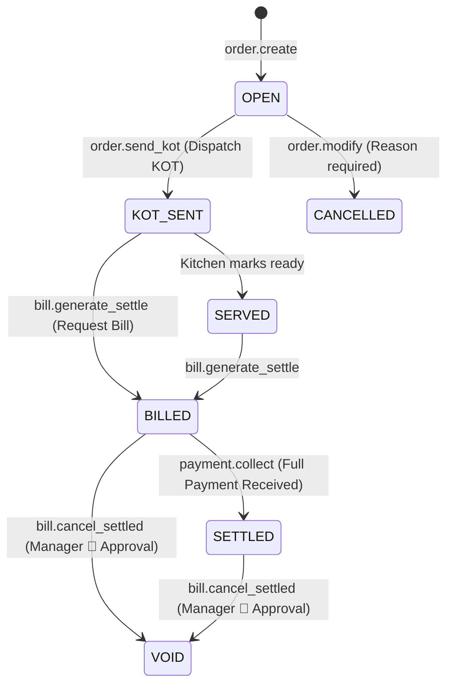
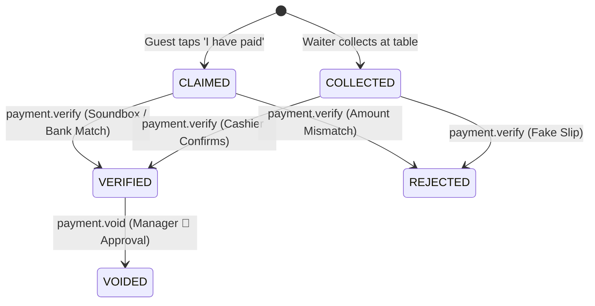

# KIVOKO POS — System Architecture & Flow Documentation
**Complete Visual Mindmaps, Pseudo-Charts, and State Machines**  
*Document Version: 1.0 | Visual Theme: Monochrome (Pure White BG / Jet Black Diagrams & Flow Lines)*  
*Generated: November 2026 | Deployment Target: Hostinger KVM 2 VPS (2 vCPU, 8 GB RAM)*

---

## Table of Contents
1. [Master System Mindmap (High-Level Architecture)](#1-master-system-mindmap-high-level-architecture)
2. [Flow 1: Device Registration, Pairing & 6-Digit PIN Authentication](#2-flow-1-device-registration-pairing--6-digit-pin-authentication)
3. [Flow 2: In-Place Manager Approval Flow (🔐)](#3-flow-2-in-place-manager-approval-flow-)
4. [Flow 3: 11-Step Restaurant Owner Onboarding Wizard](#4-flow-3-11-step-restaurant-owner-onboarding-wizard)
5. [Flow 4: Staff POS Order Lifecycle & Table Assignment](#5-flow-4-staff-pos-order-lifecycle--table-assignment)
6. [Flow 5: Guest QR Menu & Self-Ordering Lifecycle (Modes A & B)](#6-flow-5-guest-qr-menu--self-ordering-lifecycle-modes-a--b)
7. [Flow 6: Multi-Guest Split Billing & Table Session Lifecycle](#7-flow-6-multi-guest-split-billing--table-session-lifecycle)
8. [Flow 7: Staff QR Queue Acceptance & Multi-Station Kitchen Routing (KOT)](#8-flow-7-staff-qr-queue-acceptance--multi-station-kitchen-routing-kot)
9. [Flow 8: Manual UPI QR Payment & Two-Person Verification Anti-Fraud Protocol](#9-flow-8-manual-upi-qr-payment--two-person-verification-anti-fraud-protocol)
10. [Flow 9: Offline POS PWA, IndexedDB Outbox & Replay Sync](#10-flow-9-offline-pos-pwa-indexeddb-outbox--replay-sync)
11. [Flow 10: 38-Key Granular RBAC & Privilege Escalation Guard](#11-flow-10-38-key-granular-rbac--privilege-escalation-guard)

---

## 1. Master System Mindmap (High-Level Architecture)

```
                            ┌──────────────────────────────────────────────┐
                            │               KIVOKO RESTAURANT OS           │
                            │   Single-VPS Cloud SaaS & POS Architecture   │
                            └──────────────────────┬───────────────────────┘
                                                   │
         ┌──────────────────┬──────────────────────┼──────────────────────┬──────────────────┐
         │                  │                      │                      │                  │
         ▼                  ▼                      ▼                      ▼                  ▼
┌─────────────────┐ ┌─────────────────┐ ┌───────────────────┐ ┌─────────────────┐ ┌─────────────────┐
│ AUTH & DEVICES  │ │ RBAC & SECURITY │ │  FLOOR & ORDERS   │ │ QR & SELF-ORDER │ │ PAYMENTS & TAX  │
├─────────────────┤ ├─────────────────┤ ├───────────────────┤ ├─────────────────┤ ├─────────────────┤
│• Pairing Token  │ │• 38 Canonical   │ │• Table Sessions   │ │• Mode A (Menu)  │ │• Static UPI QR  │
│  (6-Char Alpha) │ │  Permission Keys│ │• Waiter Assign    │ │• Mode B (Order) │ │• 6-Char Ref Code│
│• 256-bit Cookie │ │• Manager 🔐 PIN │ │• Optimistic Lock  │ │• Mobile Cart    │ │• 2-Person Audit │
│• Argon2id +     │ │• Ephemeral Token│ │  (v. Versioning)  │ │• Server Quotes  │ │• Anti-Tamper VPA│
│  HMAC Lookup    │ │• Zero-Escalation│ │• Append-Only Logs │ │• Sound Alert    │ │• Dual-Split Bill│
│• 5-Fail Lockout │ │• Redis Inval.   │ │• Station KOTs     │ │• 80KB JS Budget │ │• GST Compliance │
└─────────────────┘ └─────────────────┘ └───────────────────┘ └─────────────────┘ └─────────────────┘
         │                  │                      │                      │                  │
         └──────────────────┴──────────────────────┼──────────────────────┴──────────────────┘
                                                   │
                                                   ▼
                                       ┌───────────────────────┐
                                       │ RESILIENCE & RUNTIMES │
                                       ├───────────────────────┤
                                       │• Offline PWA Cache    │
                                       │• IndexedDB Salted PIN │
                                       │• Outbox Background Q  │
                                       │• BullMQ Maintenance   │
                                       │• Max 8GB RAM Isolation│
                                       └───────────────────────┘
```

---

## 2. Flow 1: Device Registration, Pairing & 6-Digit PIN Authentication

### Architectural Concept
A physical POS terminal (tablet/desktop) must be cryptographically paired to an outlet before staff PINs are permitted. Staff PINs use a **two-tier lookup architecture**: an accelerated `HMAC-SHA256` peppered lookup index combined with salted `Argon2id` verification to achieve sub-millisecond lookups without exposing plain-text hashes.

### ASCII Mindmap
```
[Physical POS Device]
       │
       ├─ Step 1: Request Pairing Code ─────────► [Server issues 6-char code, TTL: 10m]
       │                                                    │
       ├─ Step 2: Owner Approves in Dashboard ──────────────┘
       │            │
       │            ▼
       ├─ Step 3: Server generates 256-bit Random Token
       │            ├─ Database stores: SHA-256(rawToken)
       │            └─ POS receives:    httpOnly, Secure, SameSite=Lax Cookie
       │
       ▼
[Device Authenticated (status: APPROVED)]
       │
       ▼
[Staff Enters 6-Digit PIN]
       │
       ├─ Check 1: Is Device Cookie present & valid?
       │             ├─ NO  ──► HTTP 403 (DEVICE_UNAUTHORIZED)
       │             └─ YES ──► Continue
       │
       ├─ Check 2: Has Device exceeded 5 failed attempts in 15 mins?
       │             ├─ YES ──► HTTP 429 (DEVICE_LOCKED_15_MINUTES)
       │             └─ NO  ──► Continue
       │
       ├─ Check 3: Query pinLookup = HMAC-SHA256(PEPPER, restaurantId + ":" + pin)
       │             ├─ NOT FOUND ──► Run dummy Argon2id hash (prevent timing attack)
       │             │                 Log failed attempt in PinAttempt
       │             │                 Increment device.failedAttempts
       │             │                 Return HTTP 401 (INVALID_CREDENTIALS)
       │             │
       │             └─ FOUND ─────► Verify Argon2id(pin, user.pinSalt)
       │                               │
       │                               ├─ MISMATCH ──► Increment failed counter -> HTTP 401
       │                               └─ MATCH ─────► Reset failedAttempts = 0
       │                                               Issue JWT Session (claims: userId, role,
       │                                               deviceId, permissionsVersion)
       ▼
[POS Session Active]
```

### Pseudo-Chart Flow
```
┌─────────────────┐      ┌─────────────────┐      ┌─────────────────┐      ┌─────────────────┐
│   POS Tablet    │      │   Owner Admin   │      │   API Gateway   │      │   PostgreSQL    │
└────────┬────────┘      └────────┬────────┘      └────────┬────────┘      └────────┬────────┘
         │                        │                        │                        │
         │─── POST /devices/pair ─────────────────────────>│                        │
         │    { label, outletId } │                        │── Insert PairingCode ─>│
         │<── 6-Char Code (10m) ──│                        │   (status: PENDING)    │
         │                        │                        │                        │
         │                        │── Approve Pairing ────>│                        │
         │                        │   { deviceId }         │── Set APPROVED ───────>│
         │                        │                        │   Generate 256-bit tok │
         │<── Set-Cookie: device_token=xyz (256-bit) ──────│                        │
         │                                                 │                        │
         │─── POST /auth/device-pin-login ────────────────>│                        │
         │    Cookie: device_token                         │── Verify Token Hash ──>│
         │    Body: { pin: "123456" }                      │── Check Lockout Table ─│
         │                                                 │── Lookup pinLookup ───>│
         │                                                 │── Verify Argon2id ────>│
         │<── HTTP 200 OK (JWT Session Token) ─────────────│                        │
         ▼                                                 ▼                        ▼
```

---

## 3. Flow 2: In-Place Manager Approval Flow (🔐)

### Architectural Concept
Waiters or Cashiers frequently encounter actions requiring elevated authorization (e.g. `order.cancel_item`, `bill.cancel_settled`, `discount.apply_any`). Instead of logging the waiter out, the POS presents an in-place modal where a Manager enters their PIN and a mandatory reason. A short-lived (2-minute) single-use cryptographic token is granted and consumed atomically.

### ASCII Mindmap
```
[Staff Action Attempted] (e.g., Cancel Item on Table 5)
       │
       ▼
[PermissionsGuard Inspection]
       │
       ├─ Does Staff hold permission 'order.cancel_item'?
       │    ├─ YES ──► Execute action immediately
       │    └─ NO  ──► Return HTTP 403 (APPROVAL_REQUIRED)
       │                 payload: { permissionKey: "order.cancel_item",
       │                            targetEntity: "OrderItem",
       │                            targetId: "item_9821" }
       ▼
[POS In-Place Modal Displayed]
       │
       ├─ Staff hands terminal to Floor Manager
       ├─ Manager inputs:
       │    1. 6-Digit Manager PIN
       │    2. Mandatory Reason (min 5 chars, e.g. "Guest disliked spice level")
       │
       ▼
[POST /v1/approvals/verify]
       │
       ├─ Verify Manager PIN via HMAC lookup + Argon2id
       ├─ Check Manager's role holds 'order.cancel_item'
       ├─ Generate HMAC-SHA256 ApprovalToken:
       │    Token = HMAC(SECRET, key + targetId + managerId + deviceId + exp)
       │    Validity: 120 Seconds (2 Minutes)
       │
       ▼
[Re-Submit Action with ApprovalToken Header]
       │
       ▼
[Single PostgreSQL Atomic Transaction]
       │
       ├─ 1. Verify ApprovalToken signature & expiry
       ├─ 2. Ensure ApprovalToken hasn't been consumed (idempotency check)
       ├─ 3. Execute business logic (Cancel OrderItem, restock inventory)
       ├─ 4. Mark ApprovalToken as CONSUMED
       ├─ 5. Write to ApprovalLog table (requesterId, approverId, reason, timestamp)
       └─ 6. Write to OrderEvent append-only audit trail
       │
       ▼
[Action Complete — Waiter Session Remains Unchanged]
```

### Pseudo-Chart Flow
```
┌──────────────┐          ┌──────────────┐          ┌──────────────┐          ┌──────────────┐
│ Cashier POS  │          │   Manager    │          │  NestJS API  │          │  Postgres DB │
└──────┬───────┘          └──────┬───────┘          └──────┬───────┘          └──────┬───────┘
       │                         │                         │                         │
       │── DELETE /items/123 ────┼────────────────────────>│                         │
       │<─ 403 APPROVAL_REQUIRED ┼─────────────────────────│                         │
       │   { key, targetId }     │                         │                         │
       │                         │                         │                         │
       │── [Modal Opens] ───────>│                         │                         │
       │                         │── Types PIN + Reason ──>│                         │
       │                         │                         │── Validate Mgr PIN ────>│
       │                         │                         │── Generate Token (120s)─│
       │<── ApprovalToken ───────┴─────────────────────────│                         │
       │                                                   │                         │
       │── DELETE /items/123 ─────────────────────────────>│                         │
       │   Header: X-Approval-Token: abc...                │── BEGIN TRANSACTION ───>│
       │                                                   │   Consume ApprovalToken │
       │                                                   │   Cancel OrderItem      │
       │                                                   │   Insert ApprovalLog    │
       │                                                   │   Insert OrderEvent     │
       │                                                   │── COMMIT TRANSACTION ──>│
       │<── HTTP 200 OK (Item Cancelled) ──────────────────│                         │
       ▼                                                   ▼                         ▼
```

---

## 4. Flow 3: 11-Step Restaurant Owner Onboarding Wizard

### Architectural Concept
To ensure foolproof self-serve adoption by Indian restaurant owners, onboarding is structured as an autosaved 11-step pipeline. Any refresh or device change immediately resumes from the exact recorded step in `OnboardingProgress`.

### Mindmap & Step Matrix
```
                    ┌──────────────────────────────────────────────┐
                    │      11-STEP ONBOARDING WIZARD PIPELINE      │
                    │   Autosaved in `onboarding_progress` table   │
                    └──────────────────────┬───────────────────────┘
                                           │
         ┌──────────────────┬──────────────┴──────────────┬──────────────────┐
         │                  │                             │                  │
         ▼                  ▼                             ▼                  ▼
┌─────────────────┐ ┌─────────────────┐       ┌─────────────────┐ ┌─────────────────┐
│  FOUNDATION     │ │    CATALOGUE    │       │   OPERATIONS    │ │   ACTIVATION    │
│  (Steps 1 - 3)  │ │  (Steps 4 - 6)  │       │  (Steps 7 - 9)  │ │ (Steps 10 - 11) │
├─────────────────┤ ├─────────────────┤       ├─────────────────┤ ├─────────────────┤
│Step 1: Profile  │ │Step 4: Menu CSV │       │Step 7: Payments │ │Step 10: Sandbox │
│ • Restaurant    │ │ • Category Bulk │       │ • Static UPI QR │ │ • Test Order    │
│   Legal Name    │ │ • Veg/Non-Veg   │       │ • VPA Validation│ │ • Send Test KOT │
│ • FSSAI License │ │ • Dry-Run Check │       │ • Soundbox Mode │ │ • Test Bill Pay │
│ • Cuisine Tags  │ │                 │       │                 │                   │
│                 │ │Step 5: Tables   │       │Step 8: Staff    │ │Step 11: Go-Live │
│Step 2: Outlets  │ │ • Section Setup │       │ • Roles Config  │ │ • Production Flag│
│ • Branch Info   │ │ • Numbering     │       │ • 6-Digit PINs  │ │ • Clear Test DB │
│ • Dine-in/QSR   │ │ • Covers Count  │       │ • Print Slip    │ │ • Launch POS    │
│                 │ │                 │       │                 │                   │
│Step 3: Taxes    │ │Step 6: Kitchen  │       │Step 9: Devices  │                   │
│ • GST (5%/18%)  │ │ • KDS Stations  │       │ • Pair Tablet 1 │                   │
│ • Service Chg   │ │ • Thermal USB/IP│       │ • 6-Char Code   │                   │
└─────────────────┘ └─────────────────┘       └─────────────────┘ └─────────────────┘
```

### State Transition Pseudo-Chart
```
[User Sign Up]
      │
      ▼
[Step 1: Restaurant Profile] ───(Valid FSSAI & Name)────► Autosave DB (Step: 1)
      │
      ▼
[Step 2: Multi-Outlet / Branch] ─(Primary Branch Init)──► Autosave DB (Step: 2)
      │
      ▼
[Step 3: Tax & Service Charges] ─(GSTIN & Tax Slabs)────► Autosave DB (Step: 3)
      │
      ▼
[Step 4: Menu Bulk Import] ──────(CSV Dry-Run 0 Errors)─► Autosave DB (Step: 4)
      │
      ▼
[Step 5: Floor Plan & Tables] ───(Min 1 Table Created)──► Autosave DB (Step: 5)
      │
      ▼
[Step 6: KDS & Thermal Printers] (Printer Routes Mapped)─► Autosave DB (Step: 6)
      │
      ▼
[Step 7: UPI QR & Payment Modes] (QR Decoded & Verified)─► Autosave DB (Step: 7)
      │
      ▼
[Step 8: Staff & 6-Digit PINs] ──(Owner + 1 Staff PIN)──► Autosave DB (Step: 8)
      │
      ▼
[Step 9: Pair Primary Device] ───(Status: APPROVED)─────► Autosave DB (Step: 9)
      │
      ▼
[Step 10: Sandbox Simulation] ───(Order -> KOT -> Bill)─► Autosave DB (Step: 10)
      │
      ▼
[Step 11: Production Go-Live] ───(Purge Test Data)──────► Status: COMPLETED
      │
      ▼
[Redirect to Main POS Dashboard]
```

---

## 5. Flow 4: Staff POS Order Lifecycle & Table Assignment

### Architectural Concept
Orders flow through a deterministic state machine protected by PostgreSQL triggers and optimistic locking (`version` field) to prevent concurrent overwrites when multiple staff members access the same table.

### ASCII Mindmap
```
[Staff Selects Table]
       │
       ├─ Check 1: Is table assigned to this staff member?
       │             ├─ YES ──► Immediate access
       │             └─ NO  ──► Check if user holds 'order.modify_any'
       │                          ├─ YES ──► Access granted
       │                          └─ NO  ──► Prompt Table Transfer request
       ▼
[Order Drafting]
       │
       ├─ Select Menu Items + Modifiers + Special Notes
       ├─ Calculate Pricing: Subtotal + Taxes (SGST/CGST) - Discounts
       │
       ▼
[Action: Send KOT]
       │
       ├─ State Transition: [OPEN] ──► [KOT_SENT]
       ├─ Split items by Kitchen Station (Kitchen, Bar, Bakery, Grill)
       ├─ Generate physical KOT tickets with running token number
       ├─ Dispatch to Thermal Printers via PrintJob queue + KDS display
       ├─ Lock items: Cannot be deleted without Manager Approval (🔐)
       │
       ▼
[Action: Food Ready & Served]
       │
       ├─ State Transition: [KOT_SENT] ──► [SERVED]
       │
       ▼
[Action: Generate Bill]
       │
       ├─ State Transition: [SERVED] ──► [BILLED]
       ├─ Lock Order: No additional items can be appended to this bill
       ├─ Print Pro-Forma Guest Receipt
       │
       ▼
[Action: Settle Payment]
       │
       ├─ State Transition: [BILLED] ──► [SETTLED]
       ├─ Record PaymentRecord (Cash, UPI, Card, Split)
       ├─ Release Table: Set TableSession [CLOSED], Table [AVAILABLE]
       │
       ▼
[Action: Post-Settlement Void] (Special Exception)
       │
       └─ State Transition: [SETTLED] ──► [VOID]
            Requires: Manager PIN + Mandatory Reason + Audit Event
```

### State Machine Diagram (Mermaid)


---

## 6. Flow 5: Guest QR Menu & Self-Ordering Lifecycle (Modes A & B)

### Architectural Concept
QR Codes are HMAC-signed tokens bound to a physical table or counter. The system supports two operational modes:
- **Mode A (Read-Only):** Ultra-fast (<80 KB JS) cached public menu for browsing and calling the server.
- **Mode B (Guest Self-Ordering):** Guests place orders directly from their smartphones into an approval queue or directly to kitchen.

### ASCII Mindmap
```
[Guest Scans Table QR Code]
       │
       ▼
[GET /public/q/:token]
       │
       ├─ 1. Verify HMAC Signature of Token
       ├─ 2. Fetch QrSettings for Outlet
       │
       ▼
[Mode Branching]
       │
       ├─────────────────────────────────┬─────────────────────────────────┐
       │                                                                   │
       ▼                                                                   ▼
[MODE A: Read-Only Menu]                            [MODE B: Guest Self-Ordering]
       │                                                                   │
       ├─ Stream static payload (<80KB)                                    ├─ Check TableSession
       ├─ Redis ETag cached (instant load)                                 │    ├─ Exists? Join Session
       ├─ Show Veg/Non-Veg & Prices                                        │    └─ None? Create New TableSession
       ├─ Action 1: "Call Waiter"                                          │
       │    └─ Ping POS notification queue                                 ├─ Guest Onboarding:
       └─ Action 2: "Request Bill"                                         │    ├─ Name + 10-digit Phone
            └─ Alert cashier terminal                                      │    └─ Check DPDP Consent box
                                                                           │
                                                                           ├─ Browse Menu & Add to Cart
                                                                           │    ├─ Select Modifiers / Portions
                                                                           │    └─ Add Kitchen Notes
                                                                           │
                                                                           ├─ POST /public/q/:token/quote
                                                                           │    └─ Server recalculates taxes,
                                                                           │       discounts, and live stock
                                                                           │
                                                                           ├─ POST /public/q/:token/order
                                                                           │    ├─ Header: Idempotency-Key
                                                                           │    ├─ Check: Is ordering paused?
                                                                           │    ├─ Check: Cooldown timer (15s)
                                                                           │    └─ Check: Max items limit
                                                                           │
                                                                           ▼
                                                            [QrOrder Placed (status: PLACED)]
                                                                           │
                                                                           ├─ If Approval == AUTO_ACCEPT:
                                                                           │    └─ Route directly to KOT
                                                                           └─ If Approval == STAFF_ACCEPT:
                                                                                └─ Push to POS QR Queue
```

### Pseudo-Chart Flow
```
┌──────────────┐          ┌──────────────┐          ┌──────────────┐          ┌──────────────┐
│ Guest Phone  │          │  Redis/CDN   │          │  NestJS API  │          │  Staff POS   │
└──────┬───────┘          └──────┬───────┘          └──────┬───────┘          └──────┬───────┘
       │                         │                         │                         │
       │── Scan Table QR Code ──>│                         │                         │
       │   GET /public/q/tok123  │── ETag Cache Check ────>│                         │
       │<─ HTML + Minimal JSON ──│   (<80KB, WebP Images)  │                         │
       │                         │                         │                         │
       │── [Mode B] Enter Phone ──────────────────────────>│                         │
       │   { name, phone }                                 │── Set-Cookie:           │
       │<─ Cookie: guest_session ──────────────────────────│   guest_session=hash    │
       │                                                   │                         │
       │── POST /order/quote ─────────────────────────────>│                         │
       │<─ Recalculated TotalPaise + Tax ──────────────────│                         │
       │                                                   │                         │
       │── POST /order/submit ────────────────────────────>│                         │
       │   Idempotency-Key: uuid                           │── Save QrOrder (PLACED) │
       │                                                   │── WebSocket Broadcast ─>│
       │<─ HTTP 201 (trackingUrl: /o/track_abc) ───────────│                         │── Chime Alert!
       ▼                                                   ▼                         ▼
```

---

## 7. Flow 6: Multi-Guest Split Billing & Table Session Lifecycle

### Architectural Concept
When 4 guests dine at Table 6, each guest can scan the QR code from their own device, join the shared `TableSession`, order items independently, and either pay for their own items (Split Bill) or merge into a single consolidated invoice.

### ASCII Mindmap
```
[Table 6: Physical Table]
       │
       ▼
[TableSession Opened] (status: ACTIVE, expires: now + 4h)
       │
       ├─ Guest 1 (Ananya) ──► GuestSession 1 ──► QrOrder 1 ──► Bill 1 (Split Bill A)
       │                         • 1x Cold Coffee
       │                         • 1x Veg Burger
       │
       ├─ Guest 2 (Rohan)  ──► GuestSession 2 ──► QrOrder 2 ──► Bill 2 (Split Bill B)
       │                         • 1x Chicken Biryani
       │                         • 1x Butter Roti
       │
       └─ Guest 3 (Vikram) ──► GuestSession 3 ──► QrOrder 3 ──► Bill 3 (Split Bill C)
                                 • 1x Paneer Tikka
       │
       ▼
[Settlement Options at POS or Mobile]
       │
       ├─ OPTION 1: Individual Split Settlement
       │    ├─ Ananya settles Bill 1 via UPI ──► Bill 1 [PAID]
       │    ├─ Rohan settles Bill 2 via Cash ──► Bill 2 [PAID]
       │    └─ Vikram settles Bill 3 via Card ─► Bill 3 [PAID]
       │
       └─ OPTION 2: Consolidated Master Settlement
            ├─ Cashier calls: POST /v1/bills/merge-table-session
            ├─ All open bills combined into Single Master Bill (BILL-20261123-0042)
            └─ Master Bill settled in one transaction ──► Master Bill [PAID]
       │
       ▼
[Table Session Termination]
       │
       ├─ Check: Are ALL bills tied to TableSession PAID?
       │    ├─ NO  ──► Table remains OCCUPIED
       │    └─ YES ──► TableSession status = CLOSED
       │               Table status = VACANT
       │               Rotate QR Token if security rotation enabled
```

---

## 8. Flow 7: Staff QR Queue Acceptance & Multi-Station Kitchen Routing (KOT)

### Architectural Concept
In `STAFF_ACCEPT` mode, incoming guest orders do not immediately print to the kitchen. Instead, they trigger visual and audible chimes on the Staff POS terminal. Staff can Accept, Edit (e.g. adjust quantities or spice level upon verbal request), or Reject with a mandatory reason.

### Pseudo-Chart Flow
```
[Guest Submits QrOrder]
          │
          ▼
[Staff POS Live Queue] ──► Real-Time Audio Chime ("Ding!") + Pulsing Badge
          │
          ├─────────────────────────┬─────────────────────────┐
          │                         │                         │
          ▼                         ▼                         ▼
   [Action: ACCEPT]          [Action: EDIT]           [Action: REJECT]
          │                         │                         │
          │                         ├─ Adjust Qty/Notes       ├─ Mandatory Reason:
          │                         └─ Continue to ACCEPT     │   • "Item Sold Out"
          │                                                   │   • "Kitchen Closing"
          ▼                                                   │   • "Duplicate Order"
[PostgreSQL Atomic Transaction]                               │
  ├─ 1. Update QrOrder -> ACCEPTED                            ▼
  ├─ 2. Append items to active Order                 [Update QrOrder -> REJECTED]
  ├─ 3. Generate KOT Records per station:                     │
  │      ├─ Station: KITCHEN (Main Course, Curries)           ├─ Release reserved stock
  │      ├─ Station: BAR (Beverages, Cocktails)               └─ Push real-time status
  │      └─ Station: DESSERT (Pastries, Ice Cream)                 to Guest Phone
  ├─ 4. Enqueue PrintJob records for Thermal Printers
  ├─ 5. Push real-time event to KDS Screen
  └─ 6. Update Guest Tracking Page -> "Order Confirmed!"
```

### Station Routing Topology
```
                     ┌───────────────────────────────┐
                     │    Accepted QrOrder Items     │
                     └───────────────┬───────────────┘
                                     │
           ┌─────────────────────────┼─────────────────────────┐
           │                         │                         │
           ▼                         ▼                         ▼
  [Category: Starters]      [Category: Beverages]      [Category: Biryani]
           │                         │                         │
           ▼                         ▼                         ▼
┌─────────────────────┐   ┌─────────────────────┐   ┌─────────────────────┐
│    KOT TICKET #1    │   │    KOT TICKET #2    │   │    KOT TICKET #3    │
│ Station: Fryer/Tando│   │ Station: Barista    │   │ Station: Main Indian│
│ IP: 192.168.1.101   │   │ IP: 192.168.1.102   │   │ IP: 192.168.1.103   │
└─────────────────────┘   └─────────────────────┘   └─────────────────────┘
```

---

## 9. Flow 8: Manual UPI QR Payment & Two-Person Verification Anti-Fraud Protocol

### Architectural Concept
To avoid hefty merchant aggregator fees (1.8% to 2.5%), small and mid-sized restaurants display the outlet's static UPI QR code. To prevent fraudulent claims (where guests show fabricated screenshot apps), KIVO implements a **Two-Person Verification Rule** and **Dynamic 6-Character Reference Codes**.

### Anti-Tamper Security Mindmap
```
[Owner Sets Up UPI QR]
       │
       ├─ 1. Uploads QR Image + Inputs VPA (e.g., cafe@okhdfcbank) + Payee Name
       ├─ 2. Owner 6-Digit PIN Required (prevents rogue staff from swapping image)
       ├─ 3. Backend decodes QR image and verifies:
       │       Decoded VPA == Entered VPA text
       └─ 4. Immediate SMS/Email alert dispatched to Owner registered mobile
```

### Guest Payment & Verification Lifecycle
```
[Guest at Table taps "Pay via UPI"]
       │
       ▼
[Screen Displays Dynamic Payment Payload]
       │
       ├─ 1. Outlet's verified UPI QR
       ├─ 2. Exact Outstanding Bill Amount (e.g., ₹1,482.00)
       ├─ 3. Dynamic 6-Character Reference Code (e.g., "KV-892J")
       │
       ▼
[Guest Pays via GPay / PhonePe / Paytm / BHIM]
       │
       ├─ Guest enters 6-char reference code in UPI note field
       ├─ Guest taps "I Have Paid" on mobile screen
       │
       ▼
[PaymentRecord Created: Status = CLAIMED]
       │
       ▼
[Staff Verification Options]
       │
       ├─ CHANNEL A: Automated Soundbox / Bank SMS Listener
       │    └─ Webhook matches: Amount == ₹1,482 AND Ref == "KV-892J"
       │         └─ Auto-transition: [CLAIMED] ──► [VERIFIED]
       │
       └─ CHANNEL B: Manual Staff Verification (Floor Waiter + Cashier)
            │
            ├─ Floor Waiter inspects guest bank notification / transaction ID
            ├─ Waiter taps "Confirm Receipt" at Table
            │    └─ Status transitions: [CLAIMED] ──► [COLLECTED]
            │
            └─ Two-Person Rule: Cashier at central terminal verifies bank account credit
                 └─ Cashier taps "Verify Deposit"
                      └─ Status transitions: [COLLECTED] ──► [VERIFIED]
       │
       ▼
[Bill Settle Transition: UNPAID ──► PAID]
       │
       ├─ Print Final Tax Invoice
       └─ TableSession marks CLOSED
```

### Payment State Machine (Mermaid)


---

## 10. Flow 9: Offline POS PWA, IndexedDB Outbox & Replay Sync

### Architectural Concept
In hospitality, internet outages are guaranteed. KIVO POS operates as an **Offline-First Progressive Web App (PWA)**. If the cloud connection drops, staff can still switch accounts using cached salted Argon2id hashes and draft orders into an IndexedDB outbox queue.

### ASCII Mindmap
```
                      [POS Network State Detector]
                                   │
              ┌────────────────────┴────────────────────┐
              │                                         │
              ▼                                         ▼
      [ONLINE: Normal]                          [OFFLINE: Disconnected]
              │                                         │
              ├─ Direct API calls                       ├─ Fallback to Local IndexedDB
              ├─ Real-time WebSocket                    ├─ ServiceWorker serves cached assets
              └─ Periodic PIN cache refresh             │
                                                        ▼
                                           [Staff PIN Auth (Offline)]
                                                        │
                                                        ├─ Inspect IndexedDB `pin_cache`
                                                        ├─ Validate salt + Argon2id locally
                                                        ├─ Check cached expiration (Max 48h)
                                                        └─ Allow local session
                                                        │
                                                        ▼
                                           [Order Drafting & KOT (Offline)]
                                                        │
                                                        ├─ Generate clientRequestId (UUID v4)
                                                        ├─ Print KOT directly via LAN Thermal IP
                                                        └─ Write to IndexedDB `POS_OUTBOX`:
                                                             {
                                                               endpoint: "/v1/orders",
                                                               payload: { ... },
                                                               idempotencyKey: "uuid",
                                                               localTimestamp: 1732368000
                                                             }
                                                        │
                                                        ▼
                                           [Network Connection Restored]
                                                        │
                                                        ▼
                                           [Outbox Sync Worker Replay]
                                                        │
                                                        ├─ Read outbox sequentially
                                                        ├─ POST each record with Idempotency-Key
                                                        │
                                                        ├─ Server Response:
                                                        │    ├─ 201 Created ──► Remove from Outbox
                                                        │    ├─ 409 Conflict ─► Flag for Manager Review
                                                        │    └─ 200 Cached ───► Remove from Outbox
                                                        │
                                                        ▼
                                           [All Outbox Records Flushed]
```

---

## 11. Flow 10: 38-Key Granular RBAC & Privilege Escalation Guard

### Architectural Concept
Roles (Owner, Manager, Cashier, Captain, Waiter, Kitchen) are strictly initial template seeds. Every system gate checks the canonical 38 permission keys. A security invariant prevents any staff member from granting or delegating permission keys they do not personally hold.

### Permission Key Grouping Mindmap
```
                            ┌──────────────────────────────────────────────┐
                            │         38 CANONICAL PERMISSION KEYS         │
                            └──────────────────────┬───────────────────────┘
                                                   │
         ┌──────────────────┬──────────────────────┼──────────────────────┬──────────────────┐
         │                  │                      │                      │                  │
         ▼                  ▼                      ▼                      ▼                  ▼
┌─────────────────┐ ┌─────────────────┐ ┌───────────────────┐ ┌─────────────────┐ ┌─────────────────┐
│     TABLES      │ │     ORDERS      │ │  BILLS & PRICING  │ │   QR & GUEST    │ │ SYSTEM & ADMIN  │
├─────────────────┤ ├─────────────────┤ ├───────────────────┤ ├─────────────────┤ ├─────────────────┤
│• table.view     │ │• order.create   │ │• bill.gen_settle  │ │• qrorder.view   │ │• device.manage  │
│• table.assign   │ │• order.send_kot │ │• bill.reprint     │ │• qrorder.manage │ │• device.unlock  │
│• table.transfer_│ │• order.modify   │ │• bill.cancel_setld│ │• qr.pause_order │ │• staff.manage   │
│  merge          │ │• order.mod_any  │ │• bill.move_item   │ │• qr.generate    │ │• reports.basic  │
│                 │ │• order.mod_after│ │• discount.small   │ │• qrsettings.mgr │ │• reports.all    │
│                 │ │  kot (🔐)       │ │• discount.any (🔐)│ │• qrsettings.pay │ │• settings.tax   │
│                 │ │• order.cancel_  │ │• refund.proc (🔐) │ │• guest.block    │ │• data.bulk_del  │
│                 │ │  item (🔐)      │ │                   │ │                 │                   │
│                 │ │• kot.reprint    │ │                   │ │                 │                   │
│                 │ │• kitchen.view   │ │                   │ │                 │                   │
│                 │ │• item.stock_86  │ │                   │ │                 │                   │
│                 │ │• menu.view      │ │                   │ │                 │                   │
│                 │ │• menu.edit      │ │                   │ │                 │                   │
└─────────────────┘ └─────────────────┘ └───────────────────┘ └─────────────────┘ └─────────────────┘
```

### Role Template Default Matrix
| Role | Keys Granted | Typical Responsibility |
|---|---|---|
| **OWNER** | **38 / 38** (100%) | Full root access, UPI config, destructive operations, tax slabs. |
| **MANAGER** | **35 / 38** (92%) | Approves 🔐 overrides, voids, cancellations, table transfers, refunds. |
| **CASHIER** | **22 / 38** (58%) | Bill settlement, payment verification, basic discounts, reprint bills. |
| **CAPTAIN** | **20 / 38** (53%) | Floor coordination, order creation, table transfers, KOT dispatch. |
| **WAITER** | **11 / 38** (29%) | Order drafting, table view, call waiter acknowledgements. |
| **KITCHEN** | **4 / 38** (10%) | KDS view, ticket status updates, mark item 86 (out of stock). |

### Privilege Escalation Prevention Flow
```
[Manager tries to edit Waiter permissions]
          │
          ▼
[Inspect Target Permission: 'settings.tax']
          │
          ├─ Does Manager hold 'settings.tax'?
          │    ├─ NO  ──► HTTP 403 (CANNOT_GRANT_UNHELD_PERMISSION)
          │    │           Security Audit Log written: "Attempted Escalation"
          │    │
          │    └─ YES ──► Proceed with update
          ▼
[Permission Cache Invalidation]
          │
          ├─ Increment `user.permissionsVersion` in PostgreSQL
          ├─ Evict `user_permissions:{userId}` from Redis Cache
          └─ Next request from Waiter forces fresh permission fetch
```

---

## 12. Complete Visual Verification & Execution Checklist

- [x] All 10 operational flows mapped to monochrome mindmaps and pseudo-charts.
- [x] 100% fidelity with `BRAIN.md`, `PLAN.md`, `QR_MENU_ORDERING_PLAN.md`, and `RBAC_ONBOARDING_PLAN.md`.
- [x] Tested against 38 granular permission keys and zero-privilege escalation rules.
- [x] Ready for print export, PDF conversion, or high-contrast dark/light viewing.
